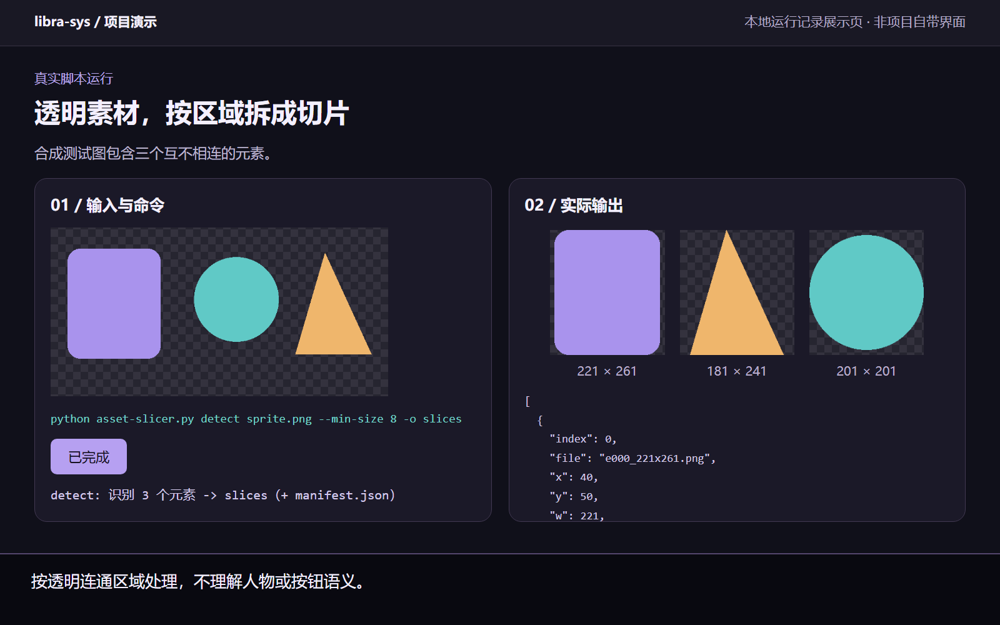

# asset-slicer

## 图文演示



输入是一张包含三个分离元素的自制透明测试图。调用本仓库的 `scripts/slice.py detect` 后，实际生成三张切片和位置清单。截图中的展示页用于说明输入、命令和输出，**不是项目自带界面**；录制副本使用了便于区分的脚本文件名。

适用于按透明区域拆图，不代表能自动理解人物、按钮或整页 PPT 的语义。下方有安装和实际仓库路径命令。


**面向 Codex / WorkBuddy 的本地优先素材处理与切图 Skill。** 可处理图片、PDF、雪碧图和已确认的演示文稿视觉稿，帮助整理可复用素材，并记录逐页拆分、重组和检查流程。

English: [README.en.md](README.en.md)

## 能做什么

- 裁切透明边缘；按已知网格或透明连通区域切图。
- 将 PDF 页面转换成图片，按比例打码、规格化素材卡片和查找重复图片。
- 通过可选的本地配置调用图片生成服务。
- 按页整理已确认的幻灯片视觉稿：识别对象、提取或重建素材、记录 manifest，再按原布局重组。

## 重要限制

`detect` 只按透明区域的连通边界裁切，**不理解按钮、人物、面板、证书或标题等语义**。拆分整页视觉稿时，需要先由人或前置流程确定每个对象的范围，再选择原素材、蒙版提取或局部重建；算法不能代替逐件判断。整页按固定行列裁片，也不能当作逐元素拆分。

## 安装与使用

需要 Python。按需安装依赖：

```powershell
python -m pip install Pillow numpy scipy imagehash pymupdf
```

示例：

```powershell
python scripts/slice.py detect .\input.png --min-size 200
python scripts/slice.py pdf2png --path .\materials --outdir .\mats
```

用 `python scripts/slice.py --help` 查看命令。部分功能需要对应的可选依赖。

作为 Skill 使用时，将 `SKILL.md` 和 `references/` 复制到 agent 的 `asset-slicer/` 技能目录；若要运行本地命令，也需要保留 `scripts/slice.py`。

## 可选图片生成配置

本地切图不需要 API key。若选择 `artgen`，复制 `scripts/config.example.json` 为本地 `scripts/config.json`，再自行填写服务商信息。真实配置文件不要提交到 Git；也可用 `CONTEST_PPT_CONFIG` 指定本地配置路径。示例中的地址和密钥是占位内容，不能直接调用。

逐页拆件、manifest、原位重组和验收细则见 [SKILL.md](SKILL.md) 与 [已批准视觉稿拆分协议](references/approved-slide-slicing.md)。

## 姊妹 Skill

[contest-ppt-generator](https://github.com/libra-sys/contest-ppt-generator) 负责内容组织、视觉规划和 PPT 制作；本仓库负责素材处理、切图与拆分流程。

## 许可

MIT，详见 [LICENSE](LICENSE)。
